# 🚀 JANSAARTHI AI

### *Aapki Zarurat. Sahi Sarkari Raasta.*
**AI-Driven Government Scheme Discovery & Assistance Platform for Marginalized Entrepreneurs**

<div align="center">

[](https://www.sih.gov.in/)
[](https://github.com/Sahil-Kumar-Chaudhary/JANSAARTHI)
[](https://github.com/Sahil-Kumar-Chaudhary/JANSAARTHI/releases)
[]()

[](https://kotlinlang.org/)
[](https://developer.android.com/jetpack/compose)
[](https://nodejs.org/)
[](https://expressjs.com/)
[](https://www.mongodb.com/atlas)
[](https://www.python.org/)
[](https://github.com/qdrant/fastembed)

[**Explore Features**](#-key-features) • [**Screenshots**](#-application-screenshots) • [**Architecture**](#️-system-architecture) • [**Installation**](#️-installation-and-setup) • [**Status & Roadmap**](#-current-development-status) • [**Release Notes**](docs/RELEASE_NOTES_v0.1.0-alpha.1.md)

</div>

---

> [!IMPORTANT]
> **Pre-Release Developer Preview (Alpha v0.1.0-alpha.1)**<br/>
> JANSAARTHI AI is currently an active developer prototype (~51% overall implementation) developed for **Smart India Hackathon 2026**. Core modules including full-stack JWT authentication, local ONNX RAG scheme retrieval, interactive EMI calculation, and Compose UI screens are fully operational. Downstream application submission flows, complete catalogue synchronization, and automated gap analyzers are under active development.

---

## 🏛️ Smart India Hackathon Problem Statement

| Field | Detail |
| :--- | :--- |
| **Hackathon Initiative** | Smart India Hackathon (SIH) 2026 |
| **Problem Statement ID** | **SIH26092** |
| **Theme / Domain** | Smart Education / Social Welfare / Inclusive E-Governance |
| **Problem Title** | AI-Driven Scheme Matching for Marginalized Entrepreneurs |
| **Target Demographics** | Women entrepreneurs, SC/ST artisans, street vendors, smallholder farmers, and rural micro-enterprises |
| **Lead Developer** | **Sahil Kumar Chaudhary** (Reg. No: 12305507) |
| **Official Repository** | [https://github.com/Sahil-Kumar-Chaudhary/JANSAARTHI](https://github.com/Sahil-Kumar-Chaudhary/JANSAARTHI) |

---

## 📖 About JANSAARTHI AI

**JANSAARTHI AI** is an intelligent, bilingual digital companion designed to democratize access to welfare benefits and credit-linked subsidies across India.

In India, hundreds of Central and State Government welfare schemes exist to promote inclusive economic empowerment—ranging from **PM Mudra Yojana**, **Stand-Up India**, and **PMEGP** to **PM Vishwakarma** and **PM-SVANidhi**. However, grassroots citizens often struggle to navigate complex eligibility terms, bureaucratic language, and scattered official portals.

JANSAARTHI AI addresses this divide by translating high-level policy guidelines into accessible, personalized guidance on mobile screens. It combines modern Android Jetpack Compose UI patterns, a resilient Node.js/Express backend, live MongoDB Atlas data management, and an offline-capable, CPU-efficient Retrieval-Augmented Generation (RAG) pipeline powered by FastEmbed ONNX embeddings.

---

## ❗ Problem We Are Solving

Grassroots entrepreneurs and marginalized citizens face four structural roadblocks when seeking government financial support:

```
┌─────────────────────────────────┐      ┌─────────────────────────────────┐
│     1. Information Vacuum       │      │   2. Multi-Factor Eligibility   │
│ Schemes scattered across 50+    │ ───► │ Age, caste, income, urban/rural │
│ central and state portals.      │      │ rules lead to confusion.        │
└─────────────────────────────────┘      └─────────────────────────────────┘
                 │                                        │
                 ▼                                        ▼
┌─────────────────────────────────┐      ┌─────────────────────────────────┐
│    3. Disconnected Documents    │      │  4. Linguistic & Jargon Barrier │
│ Citizens face bank rejections   │ ───► │ Bureaucratic gazette language   │
│ due to missing certificates.    │      │ deters first-time applicants.   │
└─────────────────────────────────┘      └─────────────────────────────────┘
```

1. **Information Fragmentation:** Schemes are siloed across distinct ministries with no unified discovery interface.
2. **Eligibility Ambiguity:** Determining whether an applicant qualifies involves cross-referencing multi-tiered income slabs, age caps, and social categories.
3. **Application Friction:** First-time applicants frequently fail bank evaluations due to incomplete document checklists.
4. **Digital & Language Divide:** Complex policy documents are written in formal English or high Hindi, alienated from ordinary citizen conversational language.

---

## 💡 Our Proposed Solution

JANSAARTHI AI resolves these challenges through a unified 5-step digital assistance pipeline:

```
[ Citizen Onboarding ] ──► [ AI Needs Understanding ] ──► [ Scheme Matching ] ──► [ Financial Clarity ] ──► [ Verified Direction ]
   3-Step KYC Form            Tri-Mode RAG Assistant         Targeted Filtering         EMI & Subsidy Calc        Official Portals
```

* **Targeted Profile Profiling:** Collects demographics, annual family income, caste category, and enterprise objectives in an accessible 3-step KYC form.
* **Dual-Modality Conversational AI:** Allows citizens to query welfare programs conversationally in everyday language using vector semantic embeddings and keyword search.
* **Strict Anti-Hallucination Grounding:** Answers cite verified scheme titles, administrative ministries, and official national portal URLs (`myScheme.gov.in`).
* **Financial Decision Support:** Interactive calculators show estimated monthly repayments, interest subventions, and capital subsidies upfront.
* **Bilingual Inclusivity:** Native runtime switching between English and Hindi.

---

## ✨ Key Features

### ✅ Currently Implemented & Verified
- **Multi-Step KYC Onboarding:** 3-step registration flow validating citizen names, contact details, 36 authentic Indian States/UTs, and districts.
- **Stateless JWT Authentication:** Secure password hashing with `bcryptjs` (salt rounds: 10), token-based session guard (`AuthGuard`), and a complete 3-step OTP password recovery flow.
- **ChatGPT-Style AI Assistant Screen:** Modern Compose UI with expanding multiline composer, action triggers, Markdown response blocks, and citation cards.
- **In-Composer Search Modes:** Embedded pill allowing real-time switching between **Hybrid**, **Semantic**, and **Keyword (Lexical)** retrieval modes.
- **Local RAG Retrieval Engine:** Python FastEmbed query engine utilizing quantized ONNX embeddings (`all-MiniLM-L6-v2`) against 100 indexed government schemes.
- **Financial EMI Calculator:** Real-time loan repayment calculator computing monthly EMI, total interest, and net subsidy deductions with interactive sliders.
- **Citizen Profile & Settings:** Profile details management with profile photo upload, local image compression (`ImageUtils`), and deletion.
- **Bilingual & Dual Theme System:** English and Hindi localization with instant runtime toggling; custom Light and Dark theme palettes.

### 🚧 Features Under Active Development (Phase 2)
- **100-Scheme Catalogue Synchronization:** Moving the static 100-scheme knowledge base into an indexed MongoDB collection.
- **Dedicated Scheme Details Screen:** Replacing placeholder screens with comprehensive scheme detail views, benefits breakdowns, and document requirements.
- **Dynamic Profile Matching:** Connecting profile attributes (income, caste, purpose) to automatically compute scheme compatibility percentages.

### 🔮 Planned Features (Roadmap Phases 3 & 4)
- **AI Eligibility Gap Analyzer:** Detailed diagnostic engine highlighting missing criteria (e.g., *Income deficit: ₹50,000 above threshold*).
- **Dynamic Document Checklist:** Automated prerequisite checklist generator based on scheme ID and applicant state/caste.
- **Personalized Application Action Plan:** Phased guidance taking the user from Udyam registration to bank branch submission.
- **Voice-Based Regional Language Assistant:** Hands-free speech recognition (STT) and voice synthesis (TTS) in regional Indian languages.
- **Persistent Multi-Session History:** Cloud-backed conversation history saved to MongoDB.

---

## 🌟 What Makes JANSAARTHI Unique

| Differentiating Capability | Conventional Portals | JANSAARTHI AI |
| :--- | :---: | :---: |
| **Conversational Discovery** | Static search by scheme name only | **Dual-modality RAG answering natural-language queries** |
| **Offline Vector Retrieval** | Requires cloud LLM roundtrips | **FastEmbed ONNX CPU embeddings (~1.1s execution)** |
| **Grounded Source Attribution** | Often provides stale or dead links | **Explicit citation of `myScheme.gov.in` records** |
| **Anti-Hallucination Guard** | High risk of hallucinated monetary caps | **Strict factual fallback when LLM keys are unconfigured** |
| **Integrated Financial Math** | External tools required | **Native loan EMI, interest subvention & subsidy calculator** |
| **Inclusive Accessibility** | Complex bureaucratic portals | **Light/Dark theme, bilingual toggles, mobile-first Compose** |

---

## 📱 Application Screenshots

<div align="center">
  <table>
    <tr>
      <td align="center"><b>🚀 Splash Screen</b></td>
      <td align="center"><b>🔐 Citizen Login</b></td>
      <td align="center"><b>📋 3-Step Registration</b></td>
    </tr>
    <tr>
      <td>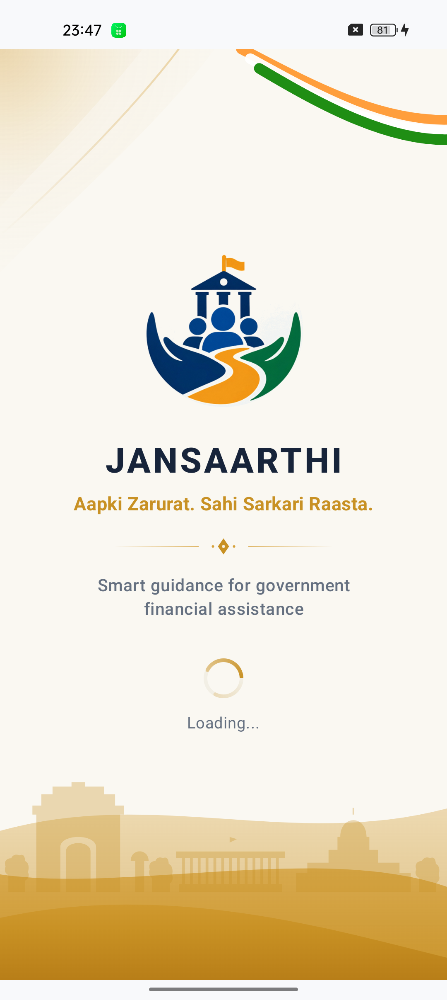</td>
      <td>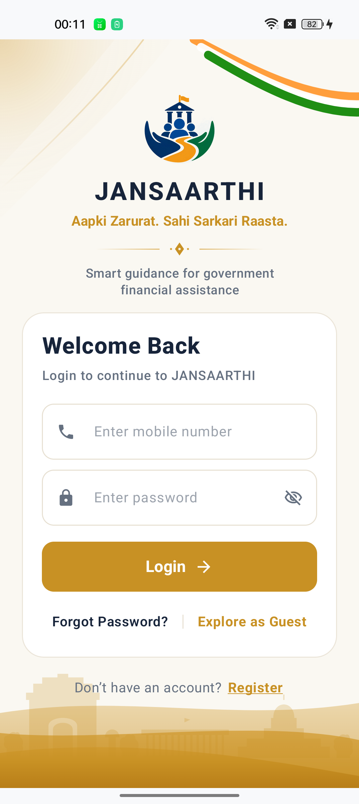</td>
      <td>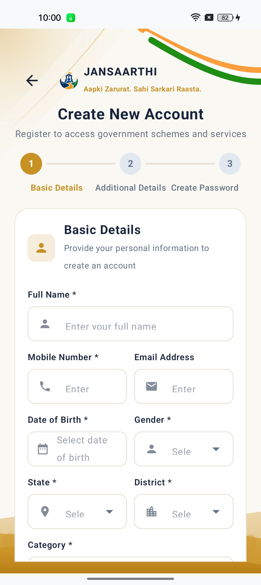</td>
    </tr>
    <tr>
      <td align="center"><b>🏠 Home Dashboard</b></td>
      <td align="center"><b>🤖 AI Assistant (RAG)</b></td>
      <td align="center"><b>👤 Citizen Profile</b></td>
    </tr>
    <tr>
      <td>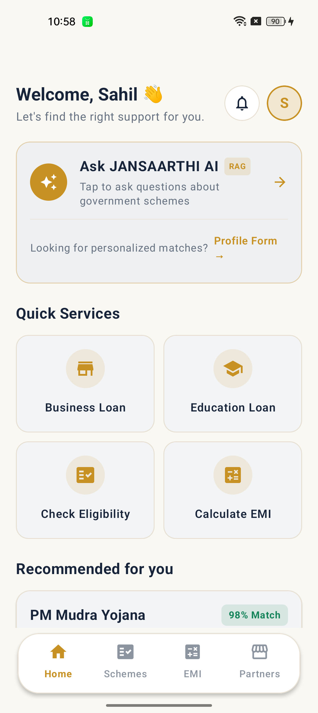</td>
      <td>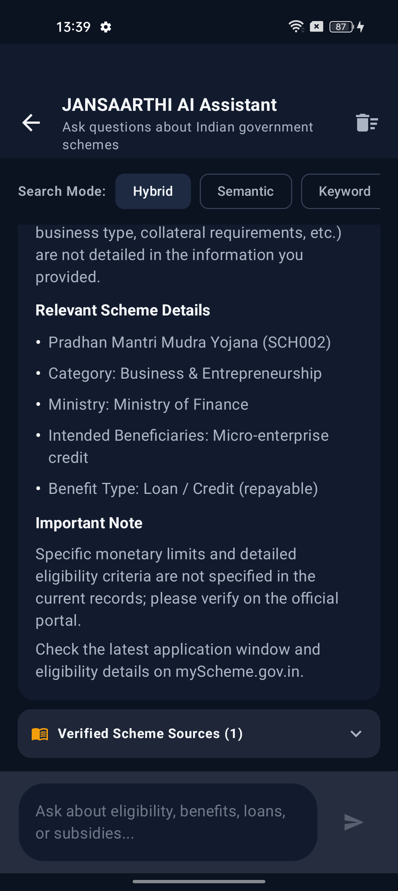</td>
      <td>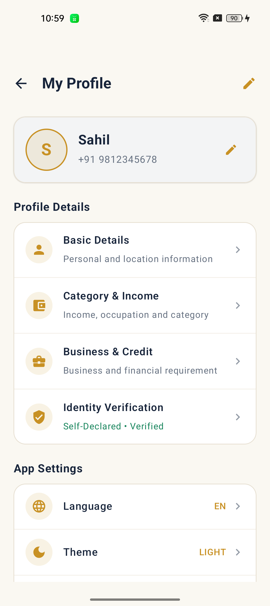</td>
    </tr>
    <tr>
      <td align="center"><b>📜 Scheme Catalogue</b></td>
      <td align="center"><b>📊 Financial Calculator</b></td>
      <td align="center"><b>📍 Channel Partners</b></td>
    </tr>
    <tr>
      <td>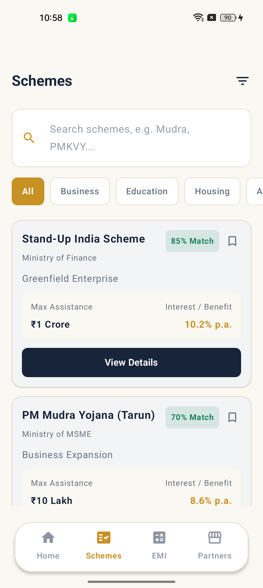</td>
      <td>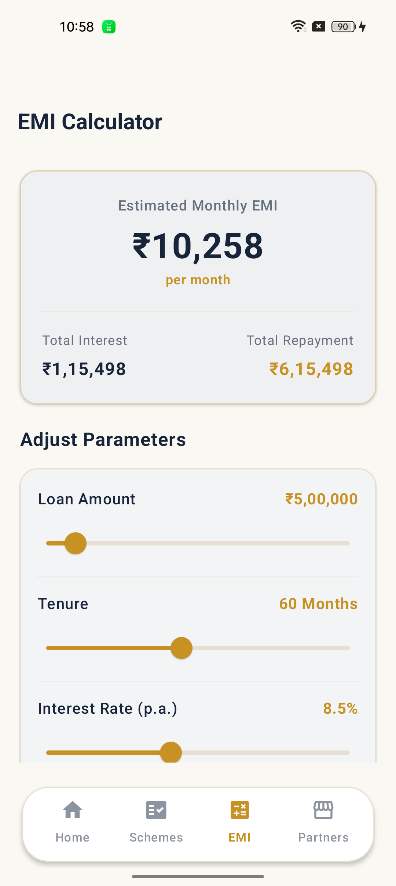</td>
      <td>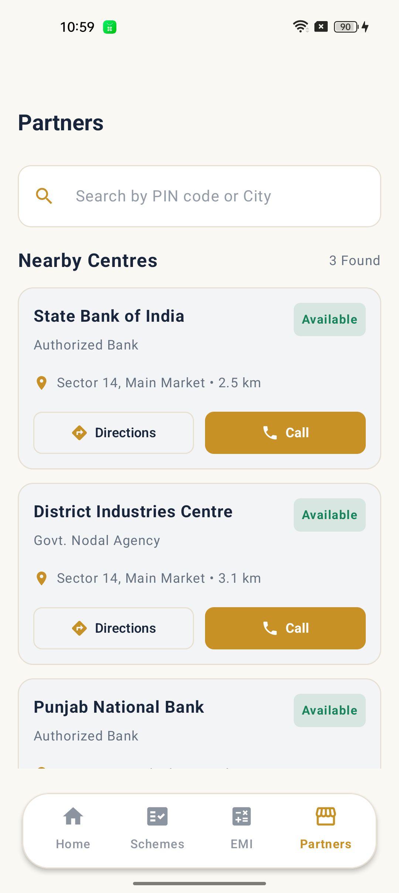</td>
    </tr>
  </table>
</div>

---

## 🔄 Complete User Journey

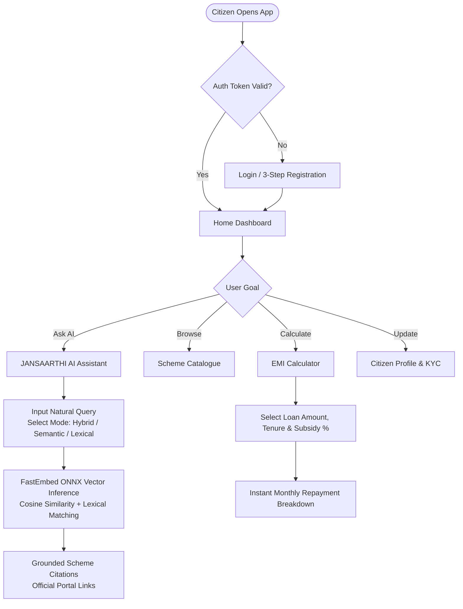

<details>
<summary><b>🔍 Click to view Journey Step Breakdown</b></summary>

1. **Onboarding & Verification:** Citizen registers using name, mobile, and password. Selects state, district, and document type.
2. **Dashboard Overview:** Displays personalized greeting, quick service cards, and recommended scheme highlights.
3. **AI Consultation:** Citizen queries welfare opportunities (e.g. *"subsidy for street vendors"*). RAG engine ranks relevant records and cites verified official sources.
4. **Financial Planning:** Citizen adjusts sliders on the EMI Calculator to calculate repayment obligations after capital subsidy deductions.
5. **Channel Partner Navigation:** Citizen explores authorized commercial banks and District Industries Centres (DIC) nearby.
</details>

---

## 🏗️ System Architecture

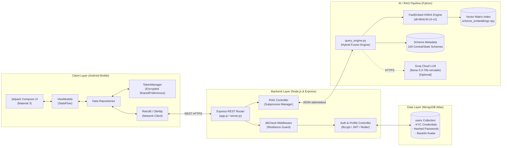

*For complete architectural specifications, see [docs/ARCHITECTURE.md](docs/ARCHITECTURE.md).*

---

## 🛠️ Technology Stack

| Domain | Technology | Purpose |
| :--- | :--- | :--- |
| **Mobile Client** | Kotlin 1.9+ | Native Android programming language |
| | Jetpack Compose | Modern declarative UI toolkit |
| | Material Design 3 | Visual styling, adaptive components, design tokens |
| | Retrofit 2.9 & OkHttp 4.12 | Type-safe REST networking and timeout management |
| | Coroutines & StateFlow | Reactive asynchronous state management (MVVM) |
| | Coil | Asynchronous image loading and avatar rendering |
| **Backend Services**| Node.js v18+ / v24.x | Scalable asynchronous JavaScript runtime |
| | Express.js 4.x | Web framework for REST API routing and middleware |
| | Mongoose ODM | Object data modeling for MongoDB Atlas |
| | bcryptjs | Secure cryptographic password hashing (salt rounds: 10) |
| | jsonwebtoken | Stateless authentication token issuance and validation |
| | multer | Multi-part form-data parsing for avatar images |
| **AI & Retrieval** | Python 3.10 - 3.12 | RAG pipeline orchestration and vector retrieval |
| | FastEmbed | Memory-mapped quantized ONNX embeddings inference |
| | `all-MiniLM-L6-v2` | 384-dimensional dense semantic vector space |
| | NumPy | High-performance matrix vector dot products and cosine similarity |
| | Groq Cloud API | Grounded LLM answer formulation (`llama-3.3-70b-versatile`) |

---

## 📂 Project Structure

```
JANSAARTHI/
├── app/                                # Android Application Module
│   ├── src/main/java/com/example/jansaarthi/
│   │   ├── data/
│   │   │   ├── local/                  # TokenManager (Encrypted SharedPreferences)
│   │   │   ├── model/                  # Data classes (AuthModels, Scheme, RagModels)
│   │   │   ├── network/                # RetrofitClient, AuthApi, RagApi
│   │   │   └── repository/             # AuthRepository, RagRepository, SettingsRepository
│   │   ├── ui/
│   │   │   ├── components/             # Reusable UI widgets (AppBottomNavigation, etc.)
│   │   │   ├── navigation/             # NavGraph, Routes, AuthGuard
│   │   │   ├── screens/                # Auth, Home, Schemes, Calculator, Profile, RAG
│   │   │   └── theme/                  # Theme.kt, Color.kt, Strings.kt (Localization)
│   │   └── utils/                      # ImageUtils (photo compression)
│   └── src/test/                       # 38 Automated Unit Tests
├── backend/                            # Node.js & Express REST Backend
│   ├── RAG/                            # Synchronized runtime bundle (query_engine.py, embeddings)
│   ├── src/
│   │   ├── config/                     # Database connection & credential sanitization
│   │   ├── controllers/                # authController, profileController, ragController
│   │   ├── middleware/                 # authMiddleware (JWT), dbCheck (resilience guard)
│   │   └── routes/                     # authRoutes, profileRoutes, ragRoutes
│   ├── tests/                          # 23 Automated Backend Tests
│   └── server.js                       # Server entry point with dynamic port binding
├── docs/                               # Comprehensive Technical Documentation
│   ├── ARCHITECTURE.md                 # System architecture and data flow specifications
│   ├── PROJECT_STATUS.md               # Detailed feature-by-feature implementation audit
│   └── RELEASE_NOTES_v0.1.0-alpha.1.md # Release notes for public Alpha preview
├── JANSAARTHI_REPORT/images/           # Authentic application UI screenshots
├── RAG/                                # Canonical Python RAG Environment & Knowledge Base
│   ├── knowledge_base/                 # Source spreadsheet (schemes.xlsx)
│   ├── semantic_index/                 # Pre-computed vector embeddings (384-dim) & metadata JSON
│   └── src/query_engine.py             # Dual-modality FastEmbed retrieval script
├── .env.example                        # Template environment configuration file
├── CHANGELOG.md                        # Version release history
├── CONTRIBUTING.md                     # Open-source contribution guidelines
└── README.md                           # Main repository documentation
```

---

## ⚙️ Installation and Setup

### 1. Prerequisites
- **Java:** JDK 17 (Java Development Kit)
- **Android Studio:** Ladybug (2024.2+) or newer
- **Node.js:** v18.0.0 or newer (v24.x verified)
- **Python:** 3.10 to 3.12 with `pip`
- **Database:** Local MongoDB server or free MongoDB Atlas cluster

---

### 2. Clone the Repository
```bash
git clone https://github.com/Sahil-Kumar-Chaudhary/JANSAARTHI.git
cd JANSAARTHI
```

---

### 3. Backend Setup & Startup
```bash
# 1. Navigate to backend directory and install dependencies
cd backend
npm install

# 2. Configure local environment variables
cp ../.env.example .env
# Edit .env with your local or Atlas MongoDB connection string

# 3. Execute backend integration test suite (23 tests)
npm test

# 4. Start the backend server
npm start
```
Verify server health in another terminal:
```bash
curl http://localhost:3000/api/health
```

---

### 4. Android Client Setup & Execution
1. Launch **Android Studio** and open the root `JANSAARTHI` folder.
2. Allow Gradle to sync and download required dependencies.
3. Configure your local backend address in `RetrofitClient.kt`:
   - Android Emulator automatically points to `http://10.0.2.2:3000/`.
   - Physical test devices connect to your Wi-Fi network IP or staging URL.
4. Run automated unit tests:
   ```powershell
   $env:JAVA_HOME = "C:\path\to\jdk17"
   .\gradlew testDebugUnitTest
   ```
5. Build and launch the debug APK:
   ```powershell
   .\gradlew assembleDebug
   ```

---

## 🔐 Environment Configuration

Create a local `backend/.env` file based on the template below.

> [!CAUTION]
> Never commit actual credentials, database passwords, or private API keys to version control. Real `.env` files are excluded by `.gitignore`.

```env
# ==============================================================================
# JANSAARTHI AI — Environment Configuration
# ==============================================================================

# Server Network Configuration
PORT=3000
NODE_ENV=development

# Database Configuration (MongoDB Atlas or Local MongoDB)
MONGODB_URI=mongodb://localhost:27017/jansaarthi
MONGODB_DB_NAME=jansaarthi

# Authentication & Security (generate a random high-entropy secret in production)
JWT_SECRET=replace_with_a_secure_random_jwt_secret_key

# RAG & Cloud LLM Inference (Optional)
# If omitted, RAG runs in deterministic offline fallback mode using verified local context.
# Obtain key at: https://console.groq.com/keys
GROQ_API_KEY=gsk_your_groq_api_key_here

# Python Runtime Configuration (Optional overrides)
# FASTEMBED_CACHE_PATH=./RAG/.cache
# PYTHON_BIN=python
```

---

## 🤖 AI and RAG Architecture

The JANSAARTHI RAG engine ([`backend/RAG/src/query_engine.py`](backend/RAG/src/query_engine.py)) operates as a dual-modality information retrieval pipeline:

```
Citizen Query ──► [ Query Preprocessing & Stopword Filtering ]
                          │
          ┌───────────────┴───────────────┐
          ▼                               ▼
[ Semantic Modality ]            [ Lexical Modality ]
FastEmbed ONNX Inference         Weighted BM25 Tokenizer
384-dim Cosine Similarity        Synonym Maps (e.g. mahila -> women)
          │                               │
          └───────────────┬───────────────┘
                          ▼
            [ Calibrated Hybrid Fusion ]
     Score = 0.55*Lex + 0.45*Sem + 10.0 Concordance
                          │
                          ▼
            [ Dynamic Relevance Pruning ]
        OOD Guard: Discard if max_sim < 0.235
                          │
                          ▼
             [ Grounded Synthesis ]
    Groq LLM (llama-3.3-70b) OR Offline Fallback
```

* **Quantized Vector Inference:** Uses FastEmbed memory-mapped ONNX weights (`sentence-transformers/all-MiniLM-L6-v2`) executing in **~1.1s on standard consumer CPUs**.
* **Out-of-Domain (OOD) Guard:** Protects against false scheme attribution; queries unrelated to public policy are rejected with zero sources and a `no_context` status.
* **Mobile-Optimized Grounding:** Synthesizes bulleted, accessible responses that exclude wide Markdown tables (which break on small mobile screens).

---

## 🔌 Backend API Overview

All API endpoints are documented below:

| Method | Endpoint | Access | Description | Status |
| :---: | :--- | :---: | :--- | :---: |
| `GET` | `/api/health` | Public | Server uptime and MongoDB connection state health check | ✅ Verified |
| `POST` | `/api/auth/register` | Public | Registers citizen account with KYC details and password | ✅ Verified |
| `POST` | `/api/auth/login` | Public | Authenticates citizen and issues 7-day JWT token | ✅ Verified |
| `POST` | `/api/auth/forgot-password` | Public | Generates 6-digit OTP with 10-minute expiry timestamp | ✅ Verified |
| `POST` | `/api/auth/verify-reset-otp`| Public | Verifies OTP and returns temporary password reset token | ✅ Verified |
| `POST` | `/api/auth/reset-password` | Public | Updates citizen password with complexity enforcement | ✅ Verified |
| `GET` | `/api/profile` | Authenticated | Fetches profile details of the authenticated citizen | ✅ Verified |
| `PUT` | `/api/profile` | Authenticated | Updates citizen demographics, income, or business details | ✅ Verified |
| `POST` | `/api/profile/photo` | Authenticated | Uploads citizen avatar image with Base64 encoding | ✅ Verified |
| `DELETE`| `/api/profile/photo` | Authenticated | Removes profile photo using atomic `$unset` | ✅ Verified |
| `POST` | `/api/rag/ask` | Public / Auth | Queries 100-scheme knowledge base via Hybrid/Semantic search | ✅ Verified |
| `GET` | `/api/schemes` | Authenticated | Full scheme catalogue listing | 🚧 Phase 2 |
| `GET` | `/api/recommendations` | Authenticated | Heuristic scheme matching endpoint | 🚧 Phase 2 |
| `GET` | `/api/eligibility` | Authenticated | Detailed eligibility criteria evaluation | 🔮 Phase 3 |
| `GET` | `/api/documents` | Authenticated | Dynamic scheme document checklists | 🔮 Phase 3 |
| `GET` | `/api/action-plans` | Authenticated | Step-by-step personalized application plan | 🔮 Phase 3 |

---

## 📊 Current Development Status

```
================================================================================
JANSAARTHI AI — Overall Project Readiness: ~51% (Alpha Prototype)
================================================================================
[███████████████████████████████░░░░░░░░░░░░░░░░░░░░░░░░░░░░░░] 51.2%
```

A comprehensive technical audit evaluated **53 distinct project components**:

* **✅ 21 Completed Modules (100%):** Core authentication, 3-step KYC registration, forgot password OTP lifecycle, profile photo management, FastEmbed ONNX RAG engine, Groq answer synthesis, bilingual toggles, Light/Dark theme, and client-side EMI calculator.
* **⚠️ 6 Partially Completed Modules (50%):** Home dashboard, scheme catalogue frontend, and logging security.
* **📦 6 Static / Mocked Modules (25%):** Recommendations endpoint, partner branches, notifications.
* **🛠️ 2 Modules Needing Fixes (70%):** Keyword mode acronym token-boundary checks.
* **🚧 17 Planned Modules (0%):** Scheme Details view, Eligibility Gap Analyzer, Dynamic Checklists, Multi-Scheme Comparison, Action Plans, and Voice Assistant.

*For full line-by-line audit metrics, see [docs/PROJECT_STATUS.md](docs/PROJECT_STATUS.md).*

---

## 🗺️ Development Roadmap

```
v0.1.0-alpha.1 (Current)
  ├── Full-stack authentication & 3-step KYC onboarding
  ├── 100-scheme knowledge base & FastEmbed ONNX RAG engine
  └── ChatGPT-style AI assistant UI & financial EMI calculator
        │
v0.2.0-alpha.1 (Upcoming Milestone)
  ├── Synchronize 100 schemes into MongoDB collection
  └── Dedicated Jetpack Compose Scheme Details screen
        │
v0.3.0-alpha.1
  ├── Automated citizen profile-to-scheme matching engine
  └── AI Eligibility Gap Analyzer (identifying missing criteria)
        │
v0.4.0-beta.1
  ├── Dynamic document checklist generator
  ├── Multi-scheme side-by-side comparison matrix
  └── Personalized step-by-step application action plan
        │
v1.0.0 (Production Candidate)
  ├── Voice-based regional language assistant (STT & TTS)
  └── Multi-session conversation history stored in MongoDB
```

---

## 🧪 Testing

The codebase enforces strict test verification across both mobile and server stacks.

### 📱 Android Unit Tests (38 Passed, 0 Failed)
```bash
.\gradlew testDebugUnitTest
```
- **RegistrationFlowUnitTest (12 tests):** Validates multi-step form transitions, underage rejection, income category mappings, and authentic Indian state/district lookups.
- **ForgotPasswordUnitTest (10 tests):** Enforces OTP length, expiry, step progression, and password complexity (uppercase, lowercase, digits, $\ge$ 8 chars).
- **RagIntegrationTest (9 tests):** Verifies RAG response parsing, timeout handling, error banners, and staging URL configurations.
- **FormattedMessageTextTest (6 tests):** Validates markdown table conversion to mobile cards, bold/italic inline parsing, and clean sanitization.
- **ExampleUnitTest (1 test):** Environment sanity test.

### ⚙️ Backend Integration Tests (23 Passed, 0 Failed)
```bash
cd backend && npm test
```
- **authForgotPassword.test.js (10 tests):** Validates OTP generation, verification, expiration, and password update constraints.
- **ragAndBackend.test.js (13 tests):** Validates RAG input constraints, Hybrid search, Semantic search, Lexical search, Out-of-Domain query rejection, deterministic fallback synthesis, and database 503 resilience guards.

---

## 🤝 Contribution Guidelines

We welcome contributions from open-source developers, academic researchers, and public-policy technologists!

1. **Fork the Repository:** Click the **Fork** button on GitHub.
2. **Create a Feature Branch:**
   ```bash
   git checkout -b feature/scheme-details-screen
   ```
3. **Write Clean Code:** Follow Kotlin and Jetpack Compose best practices, adhere to MVVM architecture, and maintain light/dark theme support.
4. **Verify Test Suites:** Ensure all tests pass prior to submitting a PR:
   ```bash
   ./gradlew testDebugUnitTest
   cd backend && npm test
   ```
5. **Submit a Pull Request:** Open a descriptive PR against the `main` branch.

*For detailed instructions, see [CONTRIBUTING.md](CONTRIBUTING.md).*

---

## 🔒 Security and Privacy

- **Password Protection:** Citizen passwords are never stored in plain text; they are hashed using `bcryptjs` with 10 salt rounds.
- **Stateless Tokens:** Authentication sessions use HMAC-SHA256 signed JSON Web Tokens (JWT) stored in Encrypted SharedPreferences via `TokenManager`.
- **Database Defense:** MongoDB URIs and credentials are sanitized in all server logs.
- **Process Isolation:** The Python RAG retrieval engine runs in a restricted child process with non-blocking stdin pipes and a 30-second timeout guard.
- **Zero Committed Secrets:** No database passwords, JWT secrets, or cloud API keys are tracked in this Git repository.

---

## 📄 License & Attribution Notice

- **Software Source Code:** Licensing is currently under evaluation by the project maintainers (Apache 2.0 recommended). See [docs/ARCHITECTURE.md](docs/ARCHITECTURE.md) for details.
- **Government Welfare Scheme Data:** Scheme titles, eligibility criteria, and administrative guidelines are public-domain information sourced from official Government of India repositories (including [myScheme.gov.in](https://www.myscheme.gov.in)). All trademarks, ministry emblems, and program names remain the property of their respective ministries.
- **Third-Party Pre-Trained Models:** FastEmbed embeddings utilize `sentence-transformers/all-MiniLM-L6-v2` licensed under Apache 2.0.

---

## 👨💻 Developer Information

<div align="center">

**Sahil Kumar Chaudhary**<br/>
*Lead Developer & System Architect*<br/>
Registration Number: **12305507**<br/>
Smart India Hackathon 2026 — Team JANSAARTHI<br/>

[](https://github.com/Sahil-Kumar-Chaudhary)
[](mailto:sahilku707@gmail.com)

</div>

---

## ⭐ Support the Project

If you find **JANSAARTHI AI** innovative or useful for public welfare and hackathon research:
- Star this repository on GitHub 🌟
- Follow development updates as we progress toward **v0.2.0-alpha.1**!
- Share feedback or open an issue for feature suggestions.

<div align="center">
  <b>Aapki Zarurat. Sahi Sarkari Raasta.</b><br/>
  Empowering Indian Micro-Entrepreneurs through Intelligent AI Guidance.
</div>
