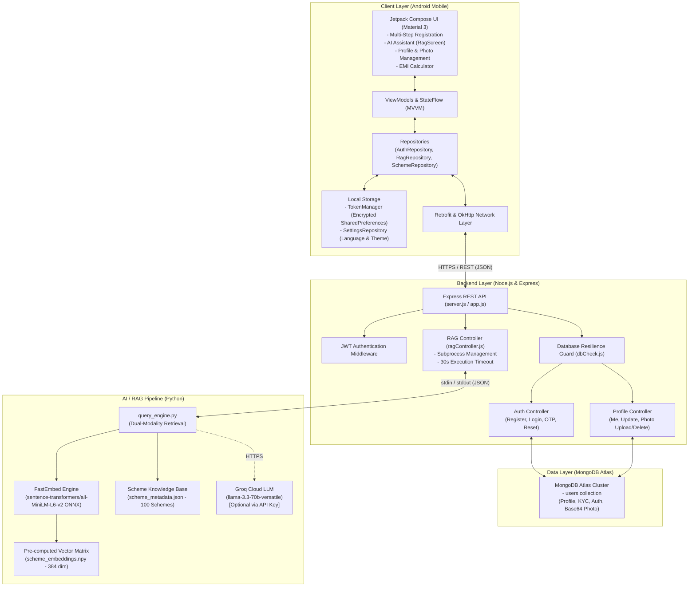

# JANSAARTHI AI — System Architecture & Data Flow

This document outlines the architecture, component interaction, and data flows of the **JANSAARTHI AI** platform (Smart India Hackathon 2026, Problem Statement: **SIH26092**).

---

## 1. High-Level Architecture Overview

---

## 2. Component Breakdown

### A. Android Client Application
- **Language & Framework:** 100% Kotlin with Jetpack Compose and Material 3.
- **Architectural Pattern:** Model-View-ViewModel (MVVM) with reactive unidirectional data flow powered by Kotlin coroutines and `StateFlow`.
- **Navigation:** Navigation Compose (`NavGraph.kt`) guarded by `AuthGuard` composables that intercept unauthenticated routes.
- **Localization:** Dynamic runtime string swapping via Compose `CompositionLocalProvider(LocalAppStrings provides appStrings)` supporting both English and Hindi.
- **Theme:** Dynamic dark/light theme switching with custom design tokens for national saffron, navy, and cream surfaces.

### B. Backend API Services
- **Runtime:** Node.js v18+ / Express.js.
- **Authentication:** Stateless JSON Web Tokens (JWT) signed with HMAC-SHA256. Passwords hashed using `bcryptjs` with 10 salt rounds.
- **Resilience Guard:** Custom `dbCheck` middleware inspects `mongoose.connection.readyState`. If the database connection drops, requests return HTTP 503 `DATABASE_UNAVAILABLE` rather than timing out.
- **Image Handling:** Multi-part form parsing via `multer` memory storage, converted directly into Base64 data URIs.

### C. RAG (Retrieval-Augmented Generation) Pipeline
- **Dual-Path Execution:** The Express controller resolves the Python binary and executes `query_engine.py` as an isolated subprocess with UTF-8 stdin/stdout piping.
- **Semantic Modality:** Uses FastEmbed running an ONNX runtime quantization of `sentence-transformers/all-MiniLM-L6-v2`. Query text is converted to a 384-dimensional vector and compared against pre-computed normalized embeddings using cosine similarity.
- **Lexical Modality:** Custom BM25-style scoring engine using alphanumeric token boundaries, domain synonym expansion (mapping colloquial terms like *mahila* $\rightarrow$ *women*, *kisan* $\rightarrow$ *farmer*), and concept coverage multipliers.
- **Hybrid Fusion:** Calibrated scoring formula:
  $$\text{Score} = (0.55 \cdot \text{LexicalScore}) + (0.45 \cdot \text{SemanticScore}) + 10.0 \ (\text{Concordance Bonus})$$
- **Out-of-Domain (OOD) Guard:** Queries with maximum similarity $< 0.235$ and maximum lexical score $< 14.0$ are immediately rejected with zero sources and a `no_context` status, preventing irrelevant scheme hallucination.
- **Answer Synthesis:** Formulates answers using Groq Cloud LLM (`llama-3.3-70b-versatile`) with strict mobile-friendly guidelines (no raw markdown tables, concise bullet points, official portal guidance). When no API key is provided, an offline deterministic grounded fallback synthesizer produces factual answers directly from verified context.

---

## 3. End-to-End Data Flows

### Flow 1: Citizen Registration & Authentication
1. User enters mobile, name, age, gender, state, district, verification document, and password in `RegisterScreen.kt`.
2. Form fields are validated on-device. `AuthRepository.register()` issues an HTTP POST to `/api/auth/register`.
3. Backend checks uniqueness in MongoDB `users` collection, hashes password with `bcryptjs`, creates the record, and signs a 7-day JWT.
4. Android client stores the token in Encrypted SharedPreferences via `TokenManager` and updates `currentUser` StateFlow.

### Flow 2: Conversational Scheme Inquiry (RAG)
1. User types query (e.g. *"financial help for pregnant women"*) in `RagScreen.kt` and selects retrieval mode (**Hybrid**, **Semantic**, or **Keyword**).
2. `RagViewModel.submitQuery()` emits loading state and dispatches query to `POST /api/rag/ask`.
3. Express controller validates input and executes `query_engine.py --stdin`.
4. Python engine loads cached embeddings (`scheme_embeddings.npy`) and scheme metadata (`scheme_metadata.json`), calculates vector similarity and lexical scores, and ranks top $k$ candidates.
5. Response payload is returned as JSON containing grounded answer text, total sources count, and verified scheme citation objects with portal links.
6. Android client parses the response and renders formatted chat bubbles with expandable citation cards.
